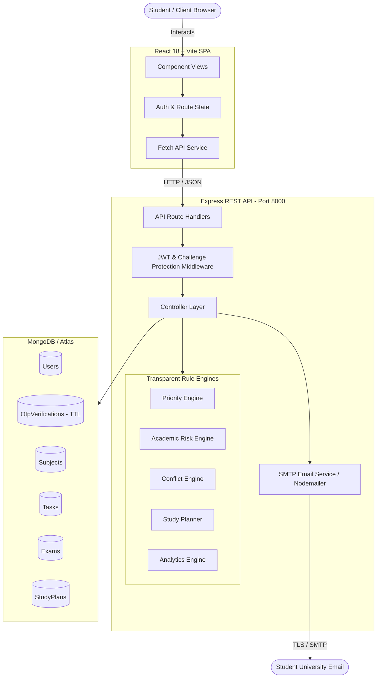

# CampusFlow AI

> **Transparent, Explainable Academic Intelligence Platform**  
> *Built with React, Node.js, Express, MongoDB, and Secure Email OTP Verification.*

[](https://nodejs.org/)
[](https://react.dev/)
[](https://www.mongodb.com/)
[](LICENSE)

---

## 1. Project Overview

**CampusFlow AI** is a production-grade full-stack academic decision-support platform designed for university students. Rather than functioning as a standard to-do list or digital syllabus tracker, CampusFlow AI implements five rule-based intelligence engines that continuously evaluate course workload, attendance thresholds, grade trajectories, and assessment deadlines to provide **transparent, explainable recommendations**.

### Problem Statement
University students are challenged by overlapping deadlines, fluctuating attendance policies (e.g., the 75% mandatory threshold), and declining performance trends across multiple subjects. Typical productivity applications present deadlines without context or weight:
> *"DBMS Assignment — Due Friday"*

CampusFlow AI assesses deadlines contextually:
> **DBMS Assignment — HIGH PRIORITY (Score: 87/100)**  
> *Due in 2 days · Estimated Effort: ~5 hours · Academic Weight: High*  
> *"Classified as High Priority because the deadline is in 2 days, requires substantial effort (~5h), and carries critical academic weight towards final evaluation."*

---

## 2. Core Objectives

1. **Explainable Task Prioritization**: Dynamically rank student workload based on deadline proximity, effort, syllabus weight, and subject difficulty.
2. **Early Academic Risk Detection**: Automatically detect attendance shortfalls (below 75%), downward grade trends, and approaching exams.
3. **Assessment Conflict Prevention**: Detect overlapping exams or assignment bottlenecks within a 48-hour window and advise mitigation steps.
4. **Intelligent Study Schedule Generation**: Automatically allocate topic review slots and reserve dedicated revision/mock buffers leading up to exams.
5. **Secure Educational Authentication**: University email validation coupled with cryptographically secure, 2-step single-use Email OTP verification.

---

## 3. Technology Stack

| Layer | Technologies & Libraries | Architectural Highlights |
|---|---|---|
| **Frontend UI** | React 18, Vite 5, Lucide Icons | Responsive SPA with URL synchronization (`history.pushState`), dark neon theme, accessible form feedback, zero-dependency layout system. |
| **Styling** | Vanilla CSS (CSS Variables) | Modern design tokens, high contrast neon-yellow branding (`#E8FF00`), responsive grid and flexbox, micro-animations. |
| **Backend API** | Node.js, Express 5 | RESTful API, centralized error handling, robust input validation, secure session management. |
| **Authentication** | JWT (`jsonwebtoken`), bcrypt (`bcryptjs`), Nodemailer | 2-step verification, challenge tokens, SHA-256 OTP hashing, university email domain enforcement. |
| **Database** | MongoDB, Mongoose 8+ | Strict schema validation, compound indices, TTL expiration cleanup indices, reference population. |
| **Testing** | Node.js Test Runner, Native Fetch | Automated end-to-end integration suite and OTP cryptographic verification suite. |

---

## 4. Architecture Overview



---

## 5. Directory Structure

```
CampusFlow-AI/
├── client/                     # Frontend Application (React 18 + Vite)
│   ├── public/                 # Static public assets
│   ├── src/
│   │   ├── components/         # Reusable UI (Sidebar, Topbar, Toast, OtpVerificationForm)
│   │   ├── pages/              # Primary route views (Dashboard, Subjects, Tasks, Exams, etc.)
│   │   ├── services/           # api.js — Centralized Fetch wrapper & session storage
│   │   ├── App.jsx             # SPA router, protected route guards, session bootstrapping
│   │   ├── index.css           # Global design system, theme tokens, layout rules
│   │   └── main.jsx            # React root mount
│   ├── .env.example            # Client environment template
│   ├── package.json            # Client dependencies and scripts
│   └── vite.config.js          # Vite configuration with /api reverse proxy
│
├── server/                     # Backend Application (Node.js + Express)
│   ├── config/                 # db.js — MongoDB connection with automatic fallback
│   ├── controllers/            # Request handlers (auth, subjects, tasks, exams, intelligence)
│   ├── middleware/             # authMiddleware (JWT & challenge token checks), errorMiddleware
│   ├── models/                 # Mongoose schemas (User, OtpVerification, Subject, Task, Exam, StudyPlan)
│   ├── routes/                 # Express route definitions (/api/auth, /api/subjects, etc.)
│   ├── scripts/                # Utility scripts (cleanNonDemoUsers.js)
│   ├── seed/                   # seedData.js — Realistic academic evaluator dataset
│   ├── services/               # Intelligence engines, emailService, otpService, validation
│   ├── test_e2e_suite.js       # End-to-end integration test runner
│   ├── test_otp_auth_flow.js   # OTP cryptographic verification test suite
│   ├── .env.example            # Server environment variable template
│   ├── package.json            # Server dependencies and scripts
│   └── server.js               # Express application entry point
│
├── .gitignore                  # Git exclusions for dependencies, environments, and caches
└── README.md                   # Complete project documentation
```

---

## 6. Authentication & Secure OTP Verification Flow

CampusFlow AI enforces a strict 2-step verification protocol for both registration and login:

```
[ Step 1: User Entry ]
  Enter University Email (@chitkara.edu.in) & Password
          ↓
[ Step 2: Backend Credential Validation ]
  - Verify email format & allowed domain policy
  - Verify password hash via bcrypt (12 rounds)
  - Reject invalid credentials immediately (401 Unauthorized)
          ↓
[ Step 3: OTP Challenge Generation & Dispatch ]
  - Generate cryptographically secure 6-digit numeric OTP (crypto.randomInt)
  - Store SHA-256 hash in MongoDB OtpVerification collection with 5-min TTL
  - Invalidate any previous unconsumed OTPs for this email
  - Issue temporary, signed challengeToken (purpose: OTP_CHALLENGE)
  - Transmit branded OTP email via SMTP / Nodemailer
          ↓
[ Step 4: Verification Screen Display ]
  - Display masked recipient address (e.g., h***@chitkara.edu.in)
  - Auto-advancing 6-box segmented numeric input with clipboard paste support
  - 5-minute expiration countdown timer
  - 60-second resend cooldown timer
          ↓
[ Step 5: OTP Submission & Validation ]
  - Verify challengeToken signature and purpose
  - Validate submitted OTP hash against active record
  - Enforce max attempt limit (5 attempts max; rejects with 429 upon exhaustion)
  - Mark OTP document as consumed (prevents replay attacks)
          ↓
[ Step 6: Session Issuance ]
  - Issue full authentication JWT token
  - Transition client session to /dashboard
```

> **Security Guarantee**: The pre-verification `challengeToken` contains `purpose: 'OTP_CHALLENGE'` and is strictly rejected by the protected route middleware (`authMiddleware`). Standard authenticated access is impossible without verifying the one-time code delivered to the student's email.

---

## 7. The Five Intelligence Engines

### 1. Task Priority Engine (`services/priorityEngine.js`)
Calculates a composite score (0–100) using a weighted algorithm:
$$\text{Priority Score} = (\text{Urgency} \times 0.40) + (\text{Effort} \times 0.20) + (\text{Academic Weight} \times 0.25) + (\text{Difficulty} \times 0.15)$$
- Automatically labels tasks as `HIGH` ($\ge 70$), `MEDIUM` ($40 - 69$), or `LOW` ($< 40$).
- Generates natural language explanations detailing *why* the priority was assigned.

### 2. Academic Risk Engine (`services/riskEngine.js`)
Continuously monitors:
- **Attendance Risk**: Flagged when attendance falls below 75% (calculates classes required to recover).
- **Performance Trend**: Detects negative slope in continuous assessment marks.
- **Exam Proximity**: Flags high-difficulty exams scheduled within 7 days.

### 3. Assessment Conflict Engine (`services/conflictEngine.js`)
Scans deadlines and exam schedules within rolling 48-hour windows. When multiple deliverables collide, it raises a conflict warning and provides re-sequencing guidance.

### 4. Intelligent Study Planner (`services/studyPlanner.js`)
Calculates days remaining until scheduled exams, reserves a mandatory buffer (2–3 days) for practice tests and comprehensive revision, and evenly spreads syllabus topics across study sessions with difficulty multipliers.

### 5. Recommendation Engine (`services/recommendationEngine.js`)
Synthesizes priority queues, attendance warnings, and study schedules into an actionable list of prioritized next steps.

---

## 8. Local Setup & Installation

### Prerequisites
- **Node.js**: v18.0.0 or higher
- **npm**: v9.0.0 or higher
- **MongoDB**: Local MongoDB instance (`mongodb://127.0.0.1:27017/campusflow`) or MongoDB Atlas URI

### Step 1: Clone Repository
```bash
git clone https://github.com/Harsh-Mangla-2927/CampusFlow-AI.git
cd CampusFlow-AI
```

### Step 2: Configure Environment Variables

**Backend Configuration:**
```bash
cp server/.env.example server/.env
```
Edit `server/.env` with your settings:
```ini
PORT=8000
NODE_ENV=development
MONGODB_URI=mongodb://127.0.0.1:27017/campusflow
JWT_SECRET=your_super_secret_jwt_key_min_32_characters
JWT_EXPIRES_IN=7d
CLIENT_URL=http://localhost:5173
ALLOWED_EMAIL_DOMAINS=chitkara.edu.in,chitkara.ac.in,campusflow.ai

# SMTP Email Verification
SMTP_HOST=smtp.gmail.com
SMTP_PORT=587
SMTP_SECURE=false
SMTP_USER=your_email@gmail.com
SMTP_PASS=your_16_char_google_app_password
EMAIL_FROM=CampusFlow AI <your_email@gmail.com>

# OTP Parameters
OTP_EXPIRY_MINUTES=5
OTP_MAX_ATTEMPTS=5
OTP_RESEND_COOLDOWN_SECONDS=60
```

**Frontend Configuration:**
```bash
cp client/.env.example client/.env
```

### Step 3: Install Dependencies
```bash
# Install backend dependencies
cd server
npm install

# Install frontend dependencies
cd ../client
npm install
cd ..
```

### Step 4: Seed Demo Data (Optional for Evaluators)
```bash
cd server
npm run seed
```
This populates realistic demo accounts (`harsh@chitkara.edu.in` and `harsh@campusflow.ai` / password `demo1234`) with enrolled subjects, attendance records, tasks, exams, and generated study schedules.

---

## 9. Running the Application

Open two terminal windows:

**Terminal 1 — Backend API Server:**
```bash
cd server
npm run dev
```
*Backend runs on `http://localhost:8000`.*

**Terminal 2 — Frontend Application:**
```bash
cd client
npm run dev
```
*Frontend runs on `http://localhost:5173`.*

---

## 10. Automated Testing

The repository includes comprehensive automated test suites:

```bash
# Run End-to-End API Integration Suite (19 tests)
cd server
node test_e2e_suite.js

# Run OTP Security, Cryptography & Replay Prevention Suite (15 tests)
node test_otp_auth_flow.js

# Verify Frontend Production Build
cd ../client
npm run build
```

---

## 11. Database Utilities

To reset test registrations and maintain only the clean demo account:
```bash
cd server
npm run clean:users
```

---

## 12. Current Implementation Status & Notes

- **Authentication & Email OTP**: Complete, cryptographically enforced with SHA-256 database storage and 60-second resend cooldowns.
- **Academic Engines**: All 5 engines (Priority, Risk, Conflict, Study Planner, Recommendations) are fully implemented and integrated.
- **Attendance & Attendly**: Self-contained attendance recording and status evaluation (Safe/Warning/Critical at 75% threshold) are complete.
- **Code Brigade / External University Portals**: Note that Code Brigade and Chitkara University ERP portals do not expose public developer APIs. Third-party scraping was intentionally omitted to prevent credential exposure. The system is designed to consume external webhooks when authorized university OAuth endpoints are released.

---

## 13. License

This project is licensed under the ISC License. Built by Harsh Mangla.
